

<picture><source media="(prefers-color-scheme: dark)" srcset="assets/hero-dark.svg"></picture>

<picture><source media="(prefers-color-scheme: dark)" srcset="assets/social-l-dark.svg"></picture><a href="https://github.com/Cgtlpa"><picture><source media="(prefers-color-scheme: dark)" srcset="assets/social-1-dark.svg"></picture></a><a href="https://discord.com/users/1403825051546943538" title="_vgzz"><picture><source media="(prefers-color-scheme: dark)" srcset="assets/social-2-dark.svg"></picture></a><a href="mailto:adrian.neub@proton.me"><picture><source media="(prefers-color-scheme: dark)" srcset="assets/social-3-dark.svg"></picture></a><picture><source media="(prefers-color-scheme: dark)" srcset="assets/social-r-dark.svg"></picture>

<picture><source media="(prefers-color-scheme: dark)" srcset="assets/about-dark.svg"></picture>

<picture><source media="(prefers-color-scheme: dark)" srcset="assets/stack-dark.svg"></picture>

## About

I'm a developer interested in systems programming, Linux, software development and game development.

- **OS:** Gentoo Linux
- **Languages:** Rust, C++, Go, Java, Lua
- **Interests:** Systems programming, Linux, game development and software engineering

## Projects

<a href="https://github.com/Cgtlpa/SilenLinux"><picture><source media="(prefers-color-scheme: dark)" srcset="assets/project-silenlinux-dark.svg"></picture></a>&nbsp;<a href="https://github.com/Cgtlpa/gotui"><picture><source media="(prefers-color-scheme: dark)" srcset="assets/project-gotui-dark.svg"></picture></a>

<a href="https://github.com/Cgtlpa/silen"><picture><source media="(prefers-color-scheme: dark)" srcset="assets/project-silen-dark.svg"></picture></a>

### Currently working on

- **Monora** – A game development project currently being developed with Rust and Macroquad.
- **Silen Linux** – An independent Linux distribution focused on simplicity, reliability and user control.
- **Cres** – A package manager written in Go, designed for the Silen Linux ecosystem.
- **gotui** – A terminal UI library written in Go.

## Contact

- **Email:** [adrian.neub@proton.me](mailto:adrian.neub@proton.me)
- **Discord:** `_vgzz`

<picture><source media="(prefers-color-scheme: dark)" srcset="assets/stats-dark.svg"></picture>

<picture><source media="(prefers-color-scheme: dark)" srcset="assets/streak-dark.svg"></picture>

<picture><source media="(prefers-color-scheme: dark)" srcset="assets/wave-dark.svg"></picture>

<picture><source media="(prefers-color-scheme: dark)" srcset="assets/button-l-dark.svg"></picture><a href="https://github.com/Cgtlpa?tab=repositories"><picture><source media="(prefers-color-scheme: dark)" srcset="assets/button-1-dark.svg"></picture></a><a href="https://github.com/Cgtlpa/SilenLinux"><picture><source media="(prefers-color-scheme: dark)" srcset="assets/button-2-dark.svg"></picture></a><a href="https://github.com/Cgtlpa/gotui"><picture><source media="(prefers-color-scheme: dark)" srcset="assets/button-3-dark.svg"></picture></a><picture><source media="(prefers-color-scheme: dark)" srcset="assets/button-r-dark.svg"></picture>

<a href="https://metawka.github.io/expressive-profile/?from=Cgtlpa"><picture><source media="(prefers-color-scheme: dark)" srcset="assets/credit-dark.svg"></picture></a>

