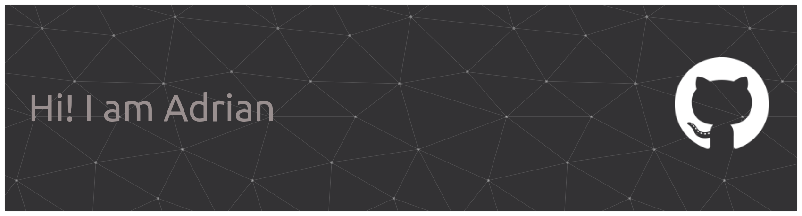

<div align="center">

`Fedora` • `Go` • `Linux` • `VS Code`

**Linux enthusiast building system tools, terminal applications and my own Linux distribution.**

<br />


</div>

---

###  About Me

-  **OS:** Fedora Linux
-  **Editor:** Visual Studio Code
-  **Main language:** Go
-  **Interests:** Linux, systems programming, TUIs and operating systems
-  *Currently building:** Silen Linux and gotui
-  **Learning:** Go, software architecture and Linux internals

I enjoy building things that interact with the system, exploring how Linux works under the hood, and turning ideas into usable software.

### Silen Linux

**My own Linux distribution.**

Silen is a project focused on creating a practical, reliable Linux experience while leaving room for customization and experimentation.

I'm working on its tools, setup experience and overall ecosystem — building more of the pieces myself as the project evolves.

### gotui

**A Go TUI framework focused on simplicity and customization.**

gotui aims to make terminal user interfaces easier to build without sacrificing flexibility. Its API lets you create interactive applications using a simple, chainable interface.

```go
app := gotui.New()
app.Title("Silen Setup")
app.Center(true)

app.Text("Welcome to Silen")
app.Select("wm", "Choose a window manager",
    "InstantWM", "Niri", "DWM",
)

if err := app.Run(); err != nil {
    // Handle errors
}
```

The goal is to make building useful terminal applications straightforward, from simple prompts to complete setup wizards.

### Technologies & Interests

- **Languages:** Go, Rust, Lua, JavaScript
- **Systems:** Linux, operating systems, system utilities
- **Development:** Terminal UIs, GUI applications, developer tools
- **Environment:** Fedora Linux, VS Code

---

<div align="center">

*Building things, learning how they work, and making Linux a little more interesting.*

</div>
